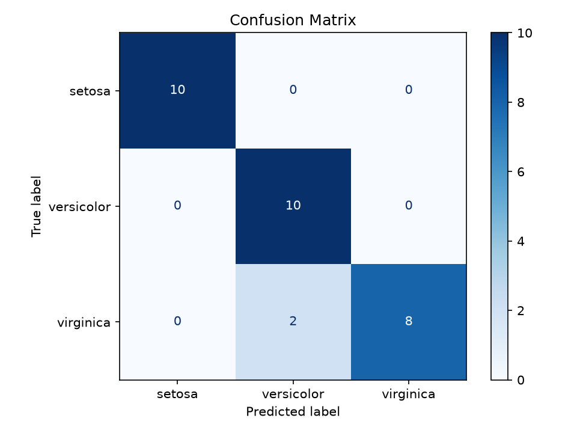
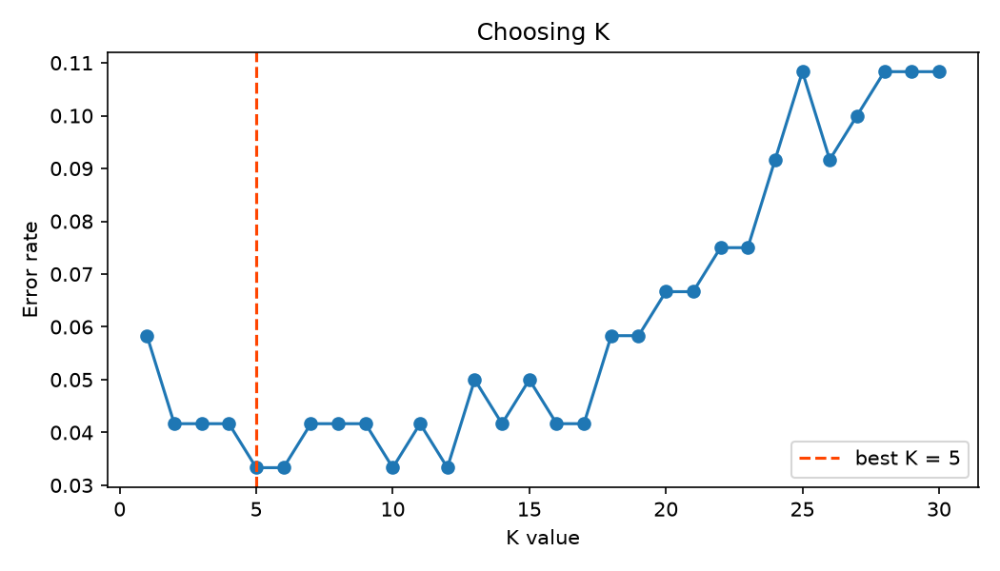

# Project 2: Data Classification Using AI

A K-Nearest Neighbors (KNN) classifier that predicts the species of an iris flower from four measurements.

## Dataset
- Iris dataset (150 samples, 3 classes, 4 features)
- Classes: Setosa, Versicolor, Virginica
- Features: sepal length, sepal width, petal length, petal width (cm)

## Pipeline
1. Load and explore the dataset
2. Shuffled, stratified 80/20 train-test split
3. Feature scaling with StandardScaler (fit on training data only)
4. Choose K using 5-fold cross-validation
5. Train the KNN model and predict on the test set
6. Evaluate with a confusion matrix, precision, recall and F1 score

## Results
- Best K: 5
- Accuracy: 93.3%
- Macro F1 score: 0.93
- The only errors were 2 Virginica flowers predicted as Versicolor.




## Predict new flowers
After the evaluation, the script asks for four measurements (sepal length, sepal width, petal length, petal width, in cm) and predicts the species. Type `q` to quit.

```
Enter 4 values separated by spaces (or 'q' to quit): 6.5 3.0 5.5 2.0
Prediction: virginica
```
## How to run
```
pip install scikit-learn pandas matplotlib
python iris_knn_classification.py
```